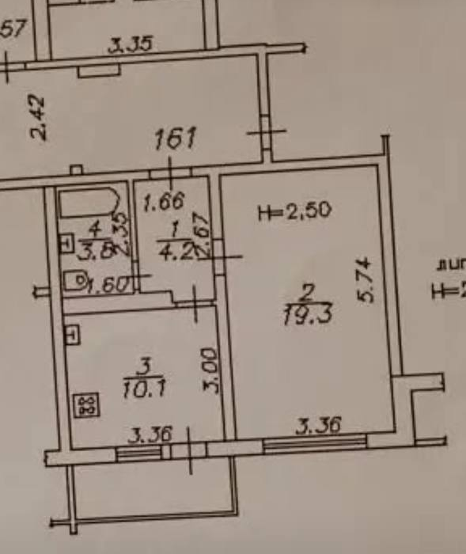

# План квартиры

[Публичная копия исходного плана](source/apartment-plan-public.png) — из приложения `IMG_8231.jpeg`, загрузка 11.10.2026. Вырезан только участок чертежа без имён и интерфейса телефона; линии и подписи внутри участка не перерисованы. Это фрагмент фотографии плана, не новый обмерный чертёж.

## Связи

- [Корневой README](../README.md) — геометрические данные и допущения.
- [Зал №2](../rooms/02-living-room/README.md), [конфигурация стен и фото](../rooms/02-living-room/configuration.md), [ТЗ зала](../technical-specs/02-living-room.md).
- [Фотокаталог зала](../rooms/02-living-room/photos/2026-10-11/README.md).

На плане: №1 — прихожая 4,2 м²; №2 — зал 19,3 м²; №3 — кухня 10,1 м²; №4 — санузел 3,8 м². Балкон примыкает к кухне и не имеет подтверждённого номера помещения; «5» в индексе ТЗ — внутренний код проекта.

Зал находится справа от прихожей. Его окно О1 — на нижней короткой стене 3,36 м, дверь Д2 — на левой длинной стене. Боковой выступ внешнего контура не переносить автоматически внутрь зала: конфигурация внутренней комнаты принимается по подписанным размерам 5,74×3,36 м до замеров. Кухонный балконный блок не является вторым окном или дверью зала.
